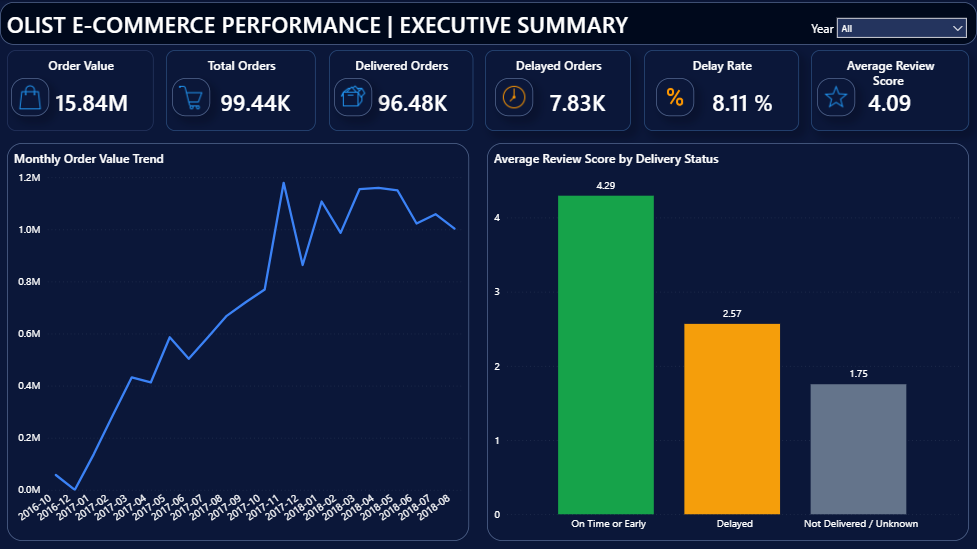
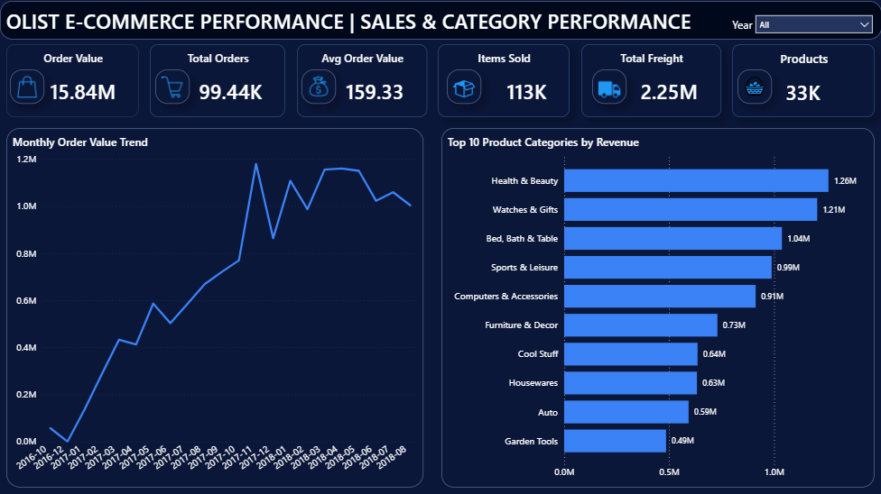
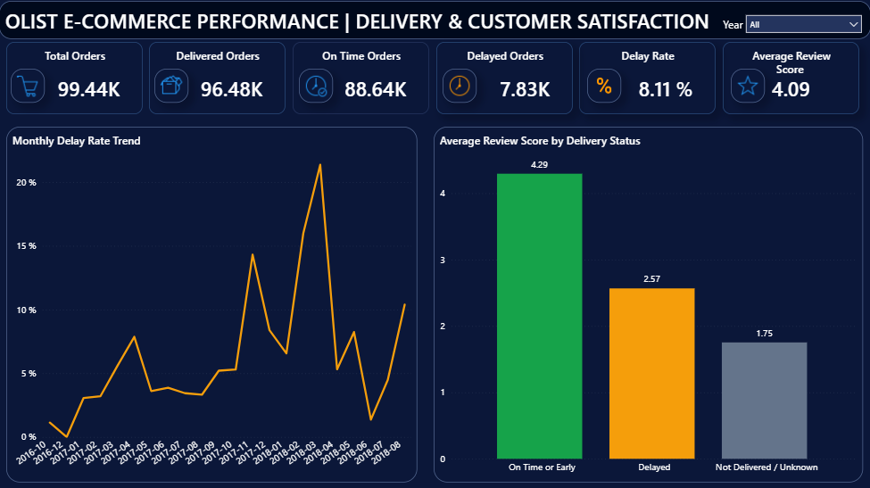
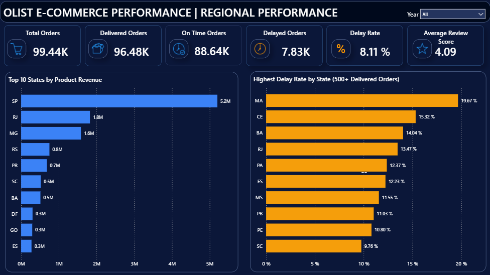
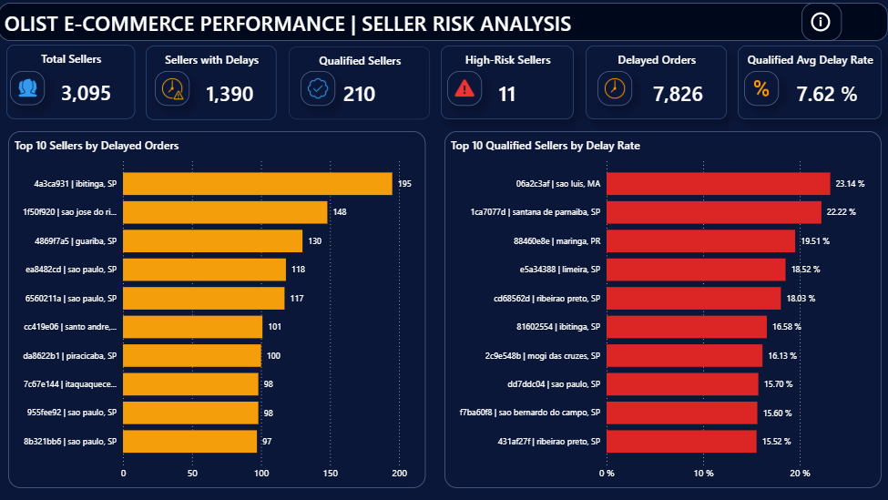

# Olist E-Commerce Performance Analysis

## Business Intelligence Case Study | SQL Server · Python · Power BI

A **SQL-to-dashboard business intelligence case study** examining order value, product categories, delivery reliability, customer reviews, regional performance, and seller risk using the historical Brazilian Olist e-commerce dataset.

The project combines an order-level and item-level SQL analytical model, cross-checked KPIs, exploratory analysis in Python, business-investigation priorities, and a five-page Power BI report. The focus is on measurable performance, transparent KPI definitions, and practical operational priorities.

## Explore the Project



**At a glance:** 99,441 orders · 15.84M recorded order value (including freight) · 8.11% delivery delay rate · 4.09/5 average review score · 11 qualified high-risk sellers.

| Start here | What you can review |
|---|---|
| [Power BI report (.pbix)](PowerBI/Olist_BI.pbix) | Five interactive report pages with imported historical data |
| [Dashboard screenshots](Dashboard_Screenshots/) | Visual review without installing Power BI |
| [SQL analytics & validation](SQL/) | Analytical views, KPI queries and data-quality checks |
| [Python analysis](Python/) | Validations, exploratory analysis and business insight scripts |
| [Exploratory findings](Python/EDA_Outputs/EDA_SUMMARY.md) | Statistical summaries and charts |
| [Business insights report](Python/Business_Insights_Outputs/BUSINESS_INSIGHTS_REPORT.md) | Operational investigation priorities |

**Opening the report:** Use Power BI Desktop to open the included `.pbix` file. Imported data should support reviewing the saved report without a SQL connection; refreshing or reproducing the analysis requires the prepared SQL Server database described below. This repository contains historical, not live, data.

---

## Table of Contents

- [Business Problem & Objectives](#business-problem--objectives)
- [Tools & Technologies](#tools--technologies)
- [Dataset Source & Attribution](#dataset-source--attribution)
- [Data Coverage & Interpretation](#data-coverage--interpretation)
- [Analytical Data Model](#analytical-data-model)
- [KPI Definitions](#kpi-definitions)
- [Executive KPI Summary](#executive-kpi-summary)
- [Power BI Dashboard](#power-bi-dashboard)
- [Python Analysis & Deliverables](#python-analysis--deliverables)
- [Key Business Insights](#key-business-insights)
- [Recommendations](#recommendations)
- [Data Quality & Validation](#data-quality--validation)
- [How to Reproduce the Analysis](#how-to-reproduce-the-analysis)
- [Repository Structure](#repository-structure)
- [Skills Demonstrated](#skills-demonstrated)
- [Limitations](#limitations)

---

## Business Problem & Objectives

Sales volume alone does not describe an e-commerce operation. Delivery reliability, product mix, regional variation, and seller execution are also relevant to customer experience and commercial performance.

This project investigates:

1. How did order volume and recorded order value change across the available purchase dates?
2. Which product categories account for the most product revenue?
3. How are delivery timing and customer reviews associated?
4. Which states show higher observed delay rates **at meaningful delivery volumes**?
5. Which qualified sellers warrant operational investigation based on both volume and delay rate?

Technical priorities include defining KPIs at the appropriate data grain, reconciling SQL and Python results, and documenting data quality limitations.

---

## Tools & Technologies

| Tool | Role |
|---|---|
| **Microsoft SQL Server / SSMS** | Analytical views, business queries, data integrity and reconciliation checks |
| **Python / Pandas** | Data validation, KPI reconciliation, exploratory aggregations and business insights |
| **Matplotlib** | Reproducible analytical charts |
| **pyodbc** | Read-only Python access to SQL Server analytical views |
| **Power BI / Power Query** | Data modeling, shaping, interactive reporting and dashboard visuals |
| **DAX** | Context-aware measures, ranking and qualification thresholds |
| **Dimensional modeling** | Separation of order facts, item facts and date dimension |

---

## Dataset Source & Attribution

- **Original dataset:** [Brazilian E-Commerce Public Dataset by Olist](https://www.kaggle.com/datasets/olistbr/brazilian-ecommerce), published by **Olist** on Kaggle (historical Brazilian marketplace orders, 2016–2018).
- **Source citation:** Olist. *Brazilian E-Commerce Public Dataset by Olist*. Kaggle, 2018.
- **Dataset license:** [Creative Commons Attribution–NonCommercial–ShareAlike 4.0 (CC BY-NC-SA 4.0)](https://creativecommons.org/licenses/by-nc-sa/4.0/), as shown on the linked Kaggle source page. Respect attribution, non-commercial use and applicable ShareAlike conditions when redistributing dataset-derived materials.
- The public dataset is the source for this case study; the SQL analytics views and Python outputs are **derived transformations**, not a separately collected dataset. The dataset provider has not endorsed this independent portfolio analysis.
- The original raw CSVs are **not included** in this portfolio repository. Check the source page for any license updates and use conditions before redistributing raw or dataset-derived files.

---

## Data Coverage & Interpretation

**Observed purchase-date range in the validated SQL model: September 4, 2016 – October 17, 2018.** The date dimension contains **774 calendar dates**.

This is **not a series of complete calendar years**. In particular, the extracted purchase-month data contains only **16 orders in September 2018** and **4 in October 2018**, compared with **6,512 in August 2018**. These sparse trailing months should not be interpreted as evidence of a business collapse, seasonality, or an operational trend. The first months are partial or sparse as well. Compare like-for-like complete periods when making time-trend claims.

The dataset is historical and not a live operational feed. Unless otherwise specified, monetary amounts below are in the **dataset's recorded currency units**; they are not converted to another currency. For comparisons, distinguish:

- **Product revenue:** sum of item prices, **excluding freight**.
- **Order/sales value:** sum of item prices **plus recorded freight values**. This is not the same as verified collected payments, profit, or shipping expense.

---

## Analytical Data Model

The analysis keeps distinct grains to avoid multiplying order-level values when an order has multiple items:

| SQL object | Grain / purpose | Validated rows |
|---|---|---:|
| `analytics.fact_orders` | One row per `order_id`; order KPIs, delivery, reviews and regions | 99,441 |
| `analytics.fact_sales` | One row per (`order_id`, `order_item_id`); products, item revenue and sellers | 112,650 |
| `analytics.dim_date` | One calendar date per row | 774 |

Supporting `clean` schema objects include `orders`, `order_items`, `customers`, `products`, `sellers`, `payments`, and `reviews_by_order`. SQL views depend on these prepared tables being present; the files in this repository do **not** on their own rebuild the complete `raw` and `clean` layers from the original CSV files.

Seller metrics are calculated using **distinct (`seller_id`, `order_id`) pairs**. An individual customer order can involve more than one seller, so counts across sellers are **not additive as globally unique orders**.

**Database constraint note:** The inspected `raw`, `clean`, and `analytics` objects returned no declared primary-key or foreign-key constraints. The project therefore checks the relevant uniqueness and key-completeness conditions through SQL/Python queries; these checks are not equivalent to database-enforced referential integrity.

---

## KPI Definitions

- **Total Orders:** distinct `order_id` values at the order grain.
- **Delivered Orders:** orders with `is_delivered = 1`.
- **On-Time or Early Orders:** delivered orders with `is_delayed = 0`.
- **Delayed Orders:** orders with `is_delayed = 1` under the validated delivery logic.
- **Unknown Delivery Timing:** delivered orders with `is_delayed IS NULL`. These are **neither on-time nor delayed**.
- **Delay Rate:** `Delayed Orders / Delivered Orders × 100`. The denominator includes delivered orders with unknown timing, matching the validated Power BI business definition.
- **Average Review Score:** average over records with an available review score, not an average that treats missing scores as zero.
- **Low-Review Rate by Delivery Status:** low-review order count divided by **all orders** in that status group; missing review scores do not reduce this denominator.
- **Average Order Value:** recorded order value divided by all orders.
- **Qualified State:** at least **500 delivered orders**.
- **Qualified Seller:** at least **100 distinct delivered seller-order pairs**.
- **High-Risk Seller:** a qualified seller with an observed delay rate of **15% or more**.
- **Qualified Average Seller Delay Rate:** the **unweighted average** of the delay rates of all 210 qualified sellers, including qualified sellers with a 0% delay rate. **This is not the national delivery delay rate.**

---

## Executive KPI Summary

| KPI | Validated result |
|---|---:|
| Total recorded order/sales value (includes freight) | **15,843,553.24** |
| Product revenue (excludes freight) | **13,591,643.70** |
| Recorded freight value | **2,251,909.54** |
| Total orders | **99,441** |
| Order items | **112,650** |
| Delivered orders | **96,478** |
| On-time or early orders | **88,644** |
| Delayed orders | **7,826** |
| Delivered orders with unknown timing | **8** |
| National delay rate | **8.11%** |
| Average order value | **159.33** |
| Average review score | **4.09 / 5** |
| Sellers in the analytical view | **3,095** |
| Qualified sellers | **210** |
| High-risk qualified sellers | **11** |
| **Unweighted average qualified seller delay rate** | **7.62%** |

**Delivery reconciliation:** `88,644 on-time/early + 7,826 delayed + 8 unknown = 96,478 delivered`.

---

## Power BI Dashboard

The Power BI report contains five pages covering executive performance, sales and categories, customer experience, regions, and seller risk.

### 1. Executive Summary


Overview of recorded order value, order volume, deliveries, delay rate and review score. The validated overall delay rate is **8.11%**. The monthly trend omits the sparse September–October 2018 purchase months; earlier observations may also be sparse or partial. Headline KPI cards represent the full available dataset.

### 2. Sales & Category Performance



Recorded order value is **15.84M**, average order value approximately **159.33**, and item count **112,650**. The ten leading product categories are ranked by **Product Revenue**, excluding freight:

| Product category | Product revenue |
|---|---:|
| Health & Beauty | 1,258,681.34 |
| Watches & Gifts | 1,205,005.68 |
| Bed, Bath & Table | 1,036,988.68 |
| Sports & Leisure | 988,048.97 |
| Computers & Accessories | 911,954.32 |

### 3. Delivery & Customer Satisfaction



| Delivery-status group | Average review | Low-review rate* |
|---|---:|---:|
| On Time or Early | **4.29 / 5** | **9.14%** |
| Delayed | **2.57 / 5** | **52.85%** |
| Not Delivered / Unknown | **1.75 / 5** | **74.49%** |

\*Low-review rates use all orders in each group as their denominator. **Not Delivered / Unknown** combines non-deliveries with cases of unknown timing; it is not a pure group of the eight delivered-but-unknown orders. These are observed associations, **not causal effects**.

### 4. Regional Performance



**SP** leads in observed product revenue. Among states with **500+ delivered orders**, the highest observed delay rates are **MA (19.67%)**, **CE (15.32%)**, **BA (14.04%)**, **RJ (13.47%)**, and **PA (12.37%)**. States below the volume threshold remain available in the full extract but are excluded from the qualified-rate ranking.

### 5. Seller Risk Analysis



There are **3,095** sellers in the analysis, **1,390** associated with at least one delayed seller-order pair, **210** qualified sellers, and **11** qualified high-risk sellers. The highest observed delay rate among qualified sellers is approximately **23.14%**. The highest observed delayed seller-order count is **195** (not necessarily a high-risk seller under the rate threshold).

The **7.62%** mean of qualified sellers' individual delay rates differs from the **8.11%** national order-level delay rate. The average includes qualified sellers with zero delayed orders. The Seller Risk page is a full-period view without a year slicer.

---

## Python Analysis & Deliverables

Four Python scripts cover SQL data validation, KPI checks, exploratory analysis, and business insights. The analytical scripts export CSV tables, charts, and concise reports.

| Script | Purpose | Validation / outputs |
|---|---|---|
| `Python/01_data_validation.py` | Row counts, keys, grain, arithmetic, date continuity and integrity | **16 PASS, 0 FAIL** |
| `Python/02_kpi_validation.py` | Recompute commercial and operational KPIs from SQL views | **32 PASS, 0 FAIL** |
| `Python/03_exploratory_analysis.py` | Monthly, category, regional, review and seller EDA | **8 CSV tables, 6 charts, 1 report** |
| `Python/04_business_insights.py` | Priority lists, product concentration, seller watchlist and interpretation | **5 CSV tables, 4 charts, 1 report** |

The exported monthly CSV retains the sparse boundary months for transparency; the Python `01_monthly_sales.png` chart displays **January 2017–August 2018** only. The full-period headline KPI values are unchanged.

Analysis outputs:

- [Exploratory analysis report](Python/EDA_Outputs/EDA_SUMMARY.md)
- [Business insights report](Python/Business_Insights_Outputs/BUSINESS_INSIGHTS_REPORT.md)
- Each output folder contains CSV aggregates and PNG charts.

The fourth script runs from the third script's CSV outputs; it does **not** require a second SQL connection. Python scripts do not modify the SQL Server database.

---

## Key Business Insights

### 1. Delivery performance and reviews are strongly associated

On-time/early orders average **4.29 / 5** versus **2.57 / 5** for delayed orders. Low-review rates are **9.14%** and **52.85%**, respectively — a gap of **43.71 percentage points**. These comparisons alone cannot determine whether delivery lateness caused the review difference.

### 2. Regional risk requires both rate and volume

**MA** has the highest qualified delay rate (**19.67%**). **RJ** has the largest *arithmetic* gap above the observed national benchmark, approximately **662.2 hypothetical delayed-order equivalents**. This is a screening metric rather than an estimate of preventable delays.

### 3. Seller thresholds reduce low-volume noise

**11 of 210** qualified sellers meet the **15%+** high-risk rule (**5.24%** of qualified sellers). The unweighted average qualified seller rate is **7.62%**. For example, the highest-rate qualified seller has **90 delayed seller-order pairs out of 389 delivered (23.14%)**, while another seller has **195 delayed seller-order pairs out of 1,772 delivered (11.00%)**. The second seller has more delayed cases but does not meet the 15% high-risk rule. This illustrates why investigations should consider both rate and operational volume, rather than using a single ranking.

### 4. Revenue concentration informs commercial monitoring

The leading category, **Health & Beauty**, contributes approximately **1.26M** in product revenue. The five largest categories together account for **39.74%** of product revenue, with freight excluded.

### 5. Temporal boundaries can distort trend interpretation

The extracted data contains only **20 orders combined in September–October 2018**. Comparing those months with a full month such as August 2018 would be misleading without an explicit completeness warning.

---

## Recommendations

1. **Investigate qualified high-risk sellers** using both observed delay rates and delayed seller-order volumes; validate individual operational circumstances before intervention.
2. **Prioritize regional investigations** by combining delay rates with order volumes. Review carrier handoffs, distances, seller composition and comparable periods before attributing causes.
3. **Monitor customer reviews alongside delivery performance**, while treating observed differences as associations and evaluating interventions with appropriate comparisons.
4. **Track important product categories using product revenue excluding freight**, and investigate whether service problems are concentrated within specific seller/region/category combinations.
5. **Exclude or flag sparse boundary months in trend comparisons** and favor like-for-like complete-month periods.

These recommendations identify opportunities for further investigation; the dataset does not measure the outcomes of implementing them.

---

## Data Quality & Validation

Validation results observed against the local SQL Server database:

- Python structural/data-quality checks: **16 PASS / 0 FAIL**.
- Python KPI checks: **32 PASS / 0 FAIL**.
- SQL validation queries: row-count, duplicate-grain, sales-total, item arithmetic, delivery mapping, date coverage, key coverage, review-range and financial-flag checks returned **PASS** in the reviewed results.
- Delivery classification passed its consistency check. The separate timing-completeness check flags **8 delivered orders** with unknown delivery timing.
- Reconciled sales value: `13,591,643.70 product revenue + 2,251,909.54 freight = 15,843,553.24 recorded value`.
- Reconciled delivered orders: `88,644 + 7,826 + 8 = 96,478`.

Data profiling also identified **775 order-level records** with missing item-derived `order_total_value` in the analytical view. Such missing values are not treated as zero in monetary sums, and their underlying cause is not determined by this analysis.

The SQL validation summary returned **five PASS results** for core counts, grain and sales-total reconciliation. Its separate delivery-timing completeness check returned **REVIEW** for the eight known unknown-timing deliveries. SQL Server also displayed non-fatal `NULL value is eliminated by an aggregate` warnings in some aggregate queries; these warnings are not a substitute for reviewing missing-value handling.

**Financial check scope:** The financial-match validation checks that the derived `is_financially_matched` flag agrees with its stated 0.01-tolerance formula. It does **not** prove that every order payment equals every item-derived order total. Recorded freight is not necessarily the seller’s or carrier’s actual shipping cost.

The validation checks assess internal consistency and selected completeness rules; they do not establish that every original source record is error-free.

---

## How to Reproduce the Analysis

### Prerequisites

- A locally configured Microsoft SQL Server instance containing a **prepared Olist analytics database** (for example, `Olist_BI`) and its `clean` tables. Without this prepared database, the four SQL and four Python files alone do not provide a complete end-to-end rebuild from the original Olist CSVs.
- SQL Server Management Studio (to inspect SQL scripts).
- Python 3 and compatible **ODBC Driver 17 for SQL Server** for the scripts that connect to SQL Server.
- Python packages `pyodbc`, `pandas`, `matplotlib`.

Install dependencies on Windows:

```powershell
py -m pip install pyodbc pandas matplotlib
```

The Python scripts default to `localhost\SQLEXPRESS` with Windows authentication and automatically locate a **single accessible Olist database containing both required analytical views**. If several databases qualify, set `OLIST_SQL_DATABASE` explicitly. Use `OLIST_SQL_SERVER` and `OLIST_ODBC_DRIVER` to override the server/driver defaults. Keep credentials out of the repository.

**SQL Server / SSMS:** Before running any `SQL/*.sql` script, select your existing prepared Olist database using the **database dropdown** in SSMS. The scripts do not hard-code a database name. For `02_analytics_views.sql`, each `CREATE OR ALTER VIEW` statement is executed only after a prerequisite check in the same SQL batch; an unsuitable database or missing required `clean` objects prevent those view changes. Other scripts perform an initial prerequisite check. Review the view definitions before executing them, because they update analytical views.

**Power BI:** The dashboard was locally tested against the prepared SQL Server database `Olist_BI` after refreshing its data and verifying the five report pages. To refresh the included `PowerBI/Olist_BI.pbix` on another computer, use **File → Options and settings → Data source settings → Change Source** to select an accessible SQL Server instance and prepared database, then refresh the report. The `.pbix` may show cached report data even when its SQL connection is unavailable; opening the report is not proof that refresh can run. SQL Server and the prepared source tables are not bundled with the repository.

### Suggested sequence

1. Inspect `SQL/01_schema_inventory.sql` to confirm the expected schemas/tables.
2. Review the definitions in `SQL/02_analytics_views.sql` before running them: this file uses **`CREATE OR ALTER VIEW`** and can update existing analytical views. It assumes prepared `clean` data is already present.
3. Use `SQL/03_business_kpis.sql` to reproduce business aggregates.
4. Run `SQL/04_validation_queries.sql` to review integrity checks and the explicit eight-order timing-completeness warning.
5. From the `Python` directory, run the scripts in this order:

```powershell
py 01_data_validation.py
py 02_kpi_validation.py
py 03_exploratory_analysis.py
py 04_business_insights.py
```

`03_exploratory_analysis.py` writes `EDA_Outputs/`. `04_business_insights.py` consumes its CSV exports and writes `Business_Insights_Outputs/`.

---

## Repository Structure

```text
./  (repository root)
├── README.md
├── .gitignore
├── Dashboard_Screenshots/
│   ├── 01_Executive_Summary.png
│   ├── 02_Sales_Category_Performance.png
│   ├── 03_Delivery_Customer_Satisfaction.png
│   ├── 04_Regional_Performance.png
│   └── 05_Seller_Risk_Analysis.png
├── PowerBI/
│   └── Olist_BI.pbix
├── SQL/
│   ├── 01_schema_inventory.sql
│   ├── 02_analytics_views.sql
│   ├── 03_business_kpis.sql
│   └── 04_validation_queries.sql
└── Python/
    ├── sql_connection.py
    ├── 01_data_validation.py
    ├── 02_kpi_validation.py
    ├── 03_exploratory_analysis.py
    ├── 04_business_insights.py
    ├── EDA_Outputs/
    │   ├── EDA_SUMMARY.md
    │   ├── *.csv
    │   └── charts/*.png
    └── Business_Insights_Outputs/
        ├── BUSINESS_INSIGHTS_REPORT.md
        ├── *.csv
        └── charts/*.png
```

---

## Skills Demonstrated

- SQL analytics and KPI design; query-based reconciliation
- Data validation, integrity testing and exception documentation
- Python/Pandas exploratory analysis and automation
- Data visualization with Matplotlib and Power BI
- DAX, Power Query, filter-context handling and dimensional modeling
- Correct treatment of order vs. order-item vs. seller-order grain
- Threshold-based regional/seller risk segmentation
- Business interpretation, prioritized investigations and communication of analytical limitations

---

## Limitations

The SQL and Python checks provide evidence of consistency for the defined KPIs and rules: **16/16 structural checks** and **32/32 KPI checks** passed. The eight orders with unknown delivery timing remain a documented completeness limitation.

Selected monthly trend visuals omit the sparse final September–October 2018 purchase months; early-series months can also be sparse or incomplete. Full-period KPI cards include all available dates. The seller-risk page summarizes the full study period. Report filters may change the relevant denominator and qualification thresholds when other date ranges are selected.

The analysis uses historical data and requires the prepared SQL database to reproduce. Observed relationships and suggested operational actions are not causal findings or measured improvements. Regional excess-versus-benchmark counts are hypothetical screening calculations, not avoidable-order estimates. Seller thresholds are investigation filters, not proof of seller wrongdoing.
